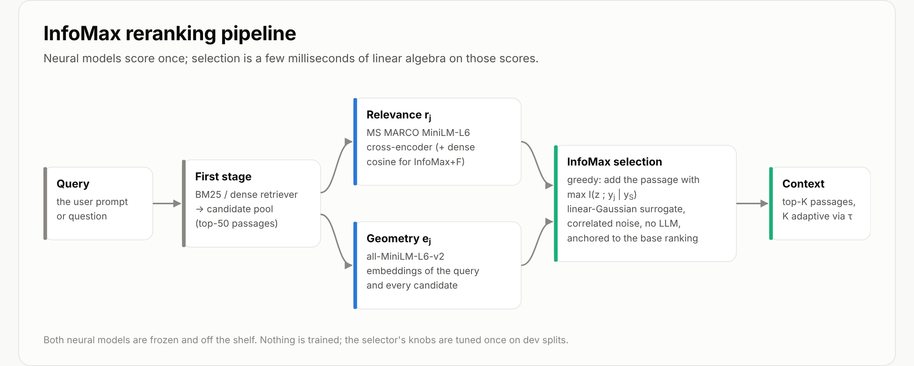
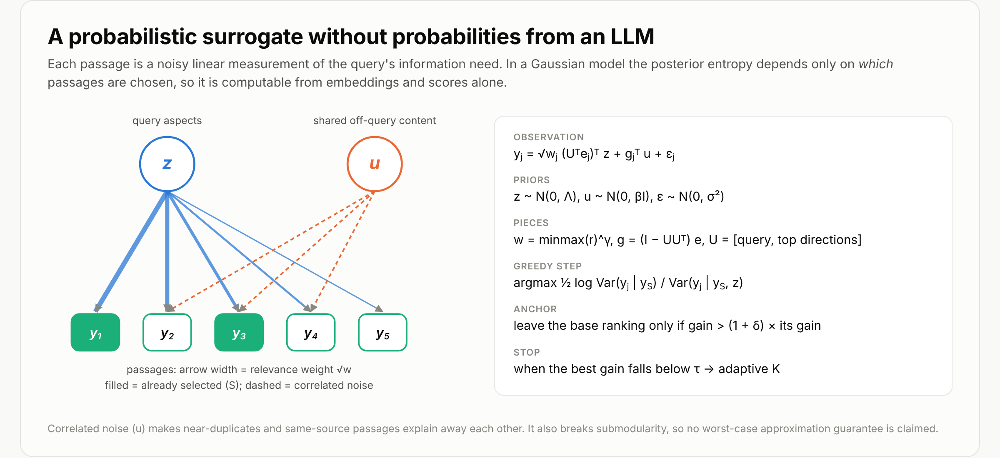
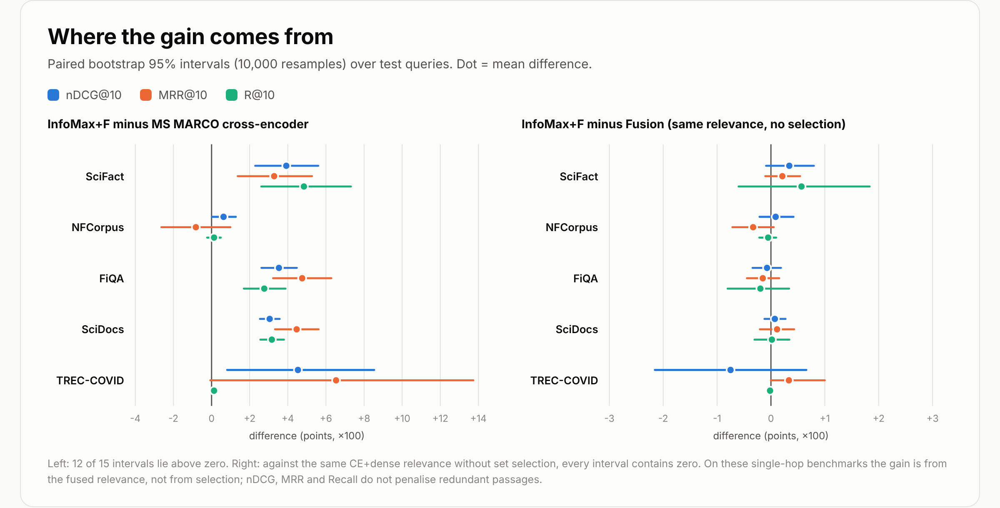

# InfoMax Reranker

Information-maximising passage selection for retrieval-augmented generation. InfoMax sits after any reranker and
picks passages one at a time, each time taking the passage that adds the most information about the query given the
passages already chosen. It needs no training and no LLM calls, and selection takes about 3 ms per query on CPU.

**Write-up (GitHub Pages, Medium-importable):** https://angshulmajumdar.github.io/infomax-reranker/



## Install

```bash
# selector only (numpy + scipy)
pip install "git+https://github.com/AngshulMajumdar/infomax-reranker"

# with the two scoring models (sentence-transformers + torch)
pip install "infomax-reranker[neural] @ git+https://github.com/AngshulMajumdar/infomax-reranker"
```

From a clone: `pip install -e ".[neural,test]"`.

## Use

### End to end

```python
from infomax_reranker import InfoMaxReranker

rr = InfoMaxReranker()                    # cross-encoder/ms-marco-MiniLM-L6-v2 + sentence-transformers/all-MiniLM-L6-v2
top = rr.rerank(query, passages, k=5)     # method="infomax+f" with the dev-tuned settings
for x in top:
    print(x["index"], x["ce_score"], x["gain"], x["passage"][:80])

top = rr.rerank(query, passages, k=10, tau=0.05)    # adaptive K: stop when a pick adds < 0.05 nats
top = rr.rerank(query, passages, k=5, method="ce")  # plain cross-encoder, for comparison
```

`method` is one of `infomax+f` (default), `infomax`, `ce`, `dense`, `fusion` or `mmr`. Pass `device="cuda"` to the
constructor to use a GPU, or other Hugging Face model ids to swap the scorers.

### With your own scores and embeddings

The selector itself needs only numpy and scipy. Give it your reranker's scores, unit-norm passage embeddings and a
unit-norm query embedding:

```python
from infomax_reranker import infomax_select, rank

selected, gains = infomax_select(scores, passage_emb, query_emb, k=10, tau=0.05)
order = rank("infomax", scores, passage_emb, query_emb, k=10)   # full permutation of the pool
```

### Command line

```bash
infomax-rerank --query "what causes tides?" --passages passages.txt --k 5          # blank-line separated passages
infomax-rerank --query "..." --passages passages.jsonl --method ce --json          # one {"text": ...} per line
```

### Settings

Defaults come from a single tuning run on dev splits (SciFact train, NFCorpus dev, FiQA dev), applied unchanged to
every test set (`infomax_reranker.TUNED`):

| knob | meaning | InfoMax+F | InfoMax |
|---|---|---|---|
| `rank` | aspect-basis size r | 4 | 1 |
| `gamma` | relevance sharpness γ, w = minmax(r)^γ | 8 | 4 |
| `rho` | prior scale of the secondary aspects | 1.0 | 0.3 |
| `sigma2` | independent noise σ² | 0.03 | 0.03 |
| `beta` | shared (correlated) noise β | 3.0 | 0 |
| `delta` | anchor margin δ (∞ = return the base ranking) | 0 | 0 |
| `alpha` | dense weight in the relevance blend | 0.5 | n/a |

## Method

For one query, every candidate j has a relevance score rⱼ and an embedding eⱼ centred on the pool mean. Each passage
is modelled as a noisy linear measurement of a latent query-aspect vector z:

    yⱼ = √wⱼ (Uᵀeⱼ)ᵀ z + gⱼᵀ u + εⱼ,   z ~ N(0, Λ),  u ~ N(0, βI),  ε ~ N(0, σ²)

Here U is the query direction plus the top relevance-weighted directions of the pool, gⱼ = (I − UUᵀ)eⱼ is the off-query
content, and the shared u correlates near-duplicates. The greedy step adds
argmaxⱼ ½ log Var(yⱼ | y_S) / Var(yⱼ | y_S, z), computed exactly by Schur complements. In a Gaussian model this entropy
reduction does not depend on observed values, so no probabilities are needed. The first pick is the base ranking's top
item, and later picks leave the base ranking only when the gain beats it by a factor of (1 + δ). No approximation
guarantee is claimed: correlated noise breaks submodularity.



## Results

Five BEIR datasets (2,321 test queries), BM25 top-50 candidates, MiniLM-L6 models, knobs tuned on dev only.
nDCG@10:

| | MS MARCO cross-encoder | InfoMax | InfoMax+F |
|---|---|---|---|
| SciFact | 0.676 | 0.695 | **0.716** |
| NFCorpus | 0.346 | 0.346 | **0.352** |
| FiQA | 0.322 | 0.337 | **0.358** |
| SciDocs | 0.164 | 0.178 | **0.194** |
| TREC-COVID | 0.744 | 0.713 | **0.790** |

MRR@10, Recall@3/5/10, the other baselines and paired bootstrap intervals are in
[`results/beir_results.md`](results/beir_results.md).

Against the cross-encoder, 12 of 15 dataset-metric intervals are above zero. Against the same fused relevance ranked
without selection, all intervals contain zero. On these single-hop benchmarks the improvement comes from the
relevance blend, not from the selection, because nDCG, MRR and Recall never penalise redundant passages.



## Repository

```
infomax_reranker/   package: core.py (selectors, numpy/scipy only), neural.py (InfoMaxReranker), cli.py
examples/           quickstart.py, precomputed_scores.py
tests/              pytest suite for the selectors
benchmark/          scripts that reproduce every BEIR number (see benchmark/README.md)
results/            BEIR tables, bootstrap intervals, per-step information gain, CPU timings
docs/               GitHub Pages site: index.html (built from article.md), styles.css, images/
space/              Gradio demo for a Hugging Face Space (ZeroGPU)
```

Run the tests with `pytest -q`.

## GitHub Pages and Medium

In the repository settings, go to Pages and choose "Deploy from a branch", branch `main`, folder `/docs`. The page
uses only tags Medium's importer keeps (headings, paragraphs, figures with captions, lists, quotes, code). To publish on
Medium, use "Import a story" with the Pages URL; the figures are pulled from `docs/images/`. After editing
`docs/article.md`, rebuild the page with `pip install markdown && python docs/build_page.py`.

## Related work

SIFT (Hübotter, Bongni, Hakimi and Krause, ICLR 2025) selects test-time fine-tuning data by reducing posterior
uncertainty about the model's response to a prompt. InfoMax applies a related criterion to RAG context selection, with
correlated noise, anchoring to a reranker and adaptive K. MMR (Carbonell and Goldstein, 1998) is the classical
relevance-against-redundancy heuristic and is included as a baseline.
