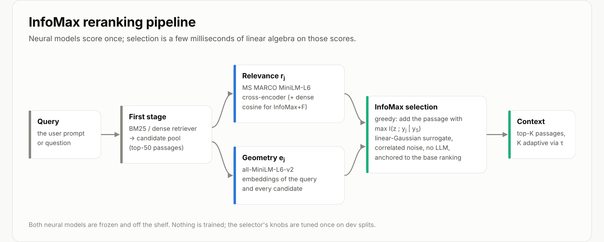
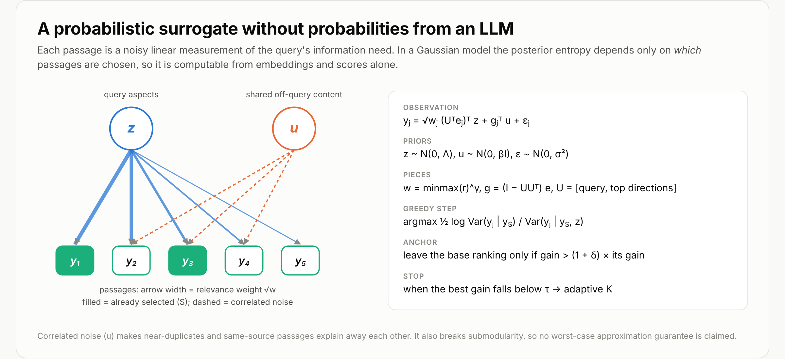
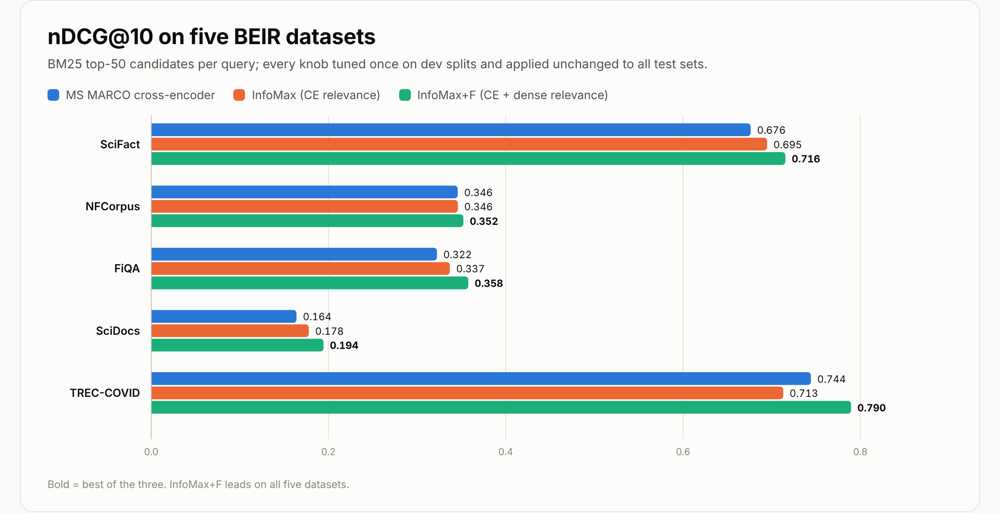
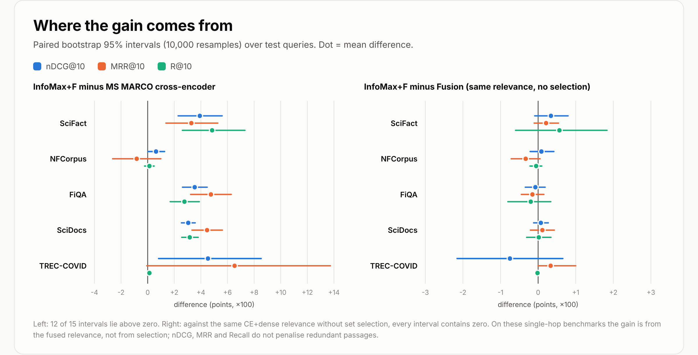
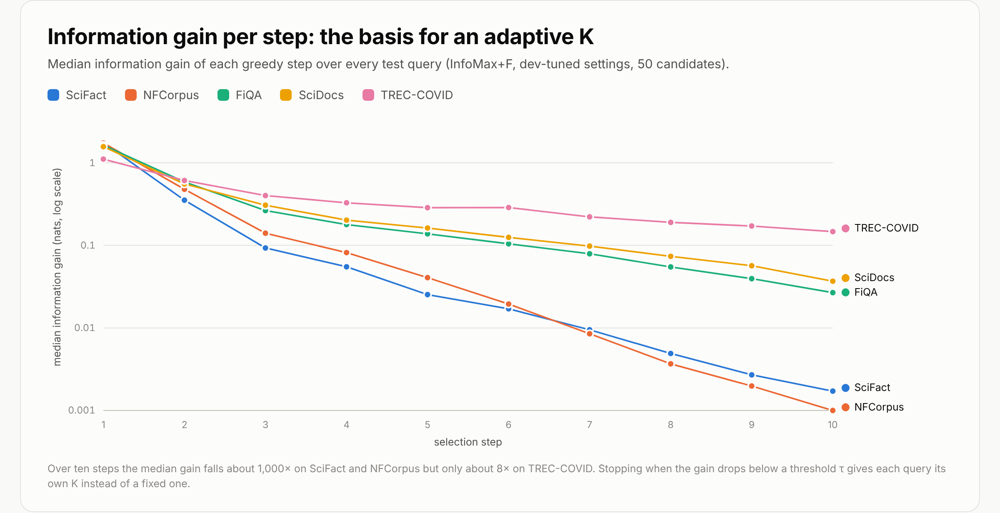
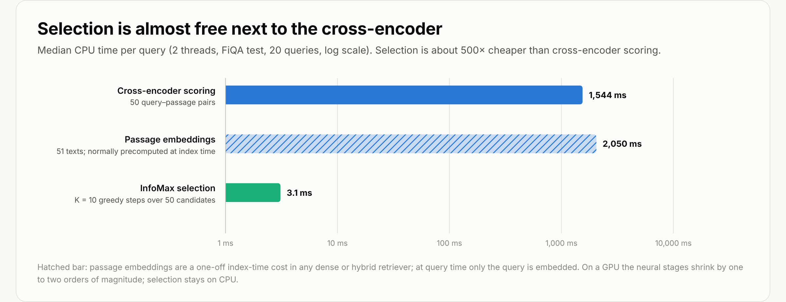

# Reranking as Information Maximisation

## Choosing retrieved passages by how much they reduce uncertainty about the query, with no LLM in the loop

*Angshul Majumdar*

Retrieval-augmented generation is usually a two-stage process. A retriever pulls a pool of candidate passages, then a reranker puts them in order, and the top few go into the prompt. The standard reranker is a cross-encoder: it reads the query and one passage together and returns a relevance score. It does this for each passage independently.

Independent scoring has a blind spot. A reranker never asks what a passage adds *given the passages already chosen*. Two near-identical passages both get high scores, and a passage that covers an aspect of the query that nothing else covers gets no credit for that.

InfoMax is a small, model-free selector that sits after any reranker. It treats each passage as a noisy measurement of what the query needs, and picks passages one at a time to maximise the information they add. It needs no training and no language-model calls, and on CPU it costs about 3 milliseconds per query.



## The problem with probabilities

"Pick the passage that most reduces uncertainty" sounds like it needs probabilities: the probability of the right answer given a set of passages. Without an LLM in the loop, those numbers don't exist.

The way around this is a Gaussian surrogate. In a linear-Gaussian model, the posterior covariance, and therefore the entropy, depends only on *which* observations you make, not on their values. So the entropy can be computed from the geometry of the embeddings and the relevance scores alone.



## The model

For one query with candidates 1 to n:

- **Relevance.** rⱼ is the cross-encoder score, or for InfoMax+F a z-score blend of the cross-encoder score and the dense cosine. The weight is wⱼ = minmax(r)ⱼ^γ.
- **Geometry.** eⱼ is the all-MiniLM-L6-v2 embedding, centred on the pool mean.
- **Target.** z is a latent vector of query aspects on a small basis U: the query direction plus the top relevance-weighted directions of the pool.
- **Observation.** yⱼ = √wⱼ (Uᵀeⱼ)ᵀ z + gⱼᵀ u + εⱼ, where gⱼ = (I − UUᵀ)eⱼ is the off-query part of the passage.
- **Correlated noise.** u is shared across passages. Near-duplicates and passages from the same source therefore have correlated errors and explain each other away.

Each greedy step adds the passage with the largest conditional mutual information:

> I(z; yⱼ | y_S) = ½ log [ Var(yⱼ | y_S) / Var(yⱼ | y_S, z) ]

Both variances are Schur complements, so each step is exact and costs O(n²).

Two safeguards keep the selector close to the reranker it builds on:

- **Anchoring.** The first pick is always the reranker's top passage. Afterwards, the reranker's next passage is replaced only if the best gain beats its gain by a factor of (1 + δ). With δ = ∞ the output is exactly the reranker's ranking.
- **Adaptive K.** Selection stops when the best gain drops below a threshold τ, so each query gets its own number of passages.

No approximation guarantee is claimed. With independent noise the objective would be submodular and greedy would be within (1 − 1/e) of the optimum, but passages are not independent, and correlated noise breaks that property. The model was chosen to be right rather than provable.

## Experimental setup

- **Data.** Five BEIR datasets: SciFact, NFCorpus, FiQA, SciDocs and TREC-COVID, 2,321 test queries in all.
- **Candidates.** BM25 top-50 per query (k1 = 0.9, b = 0.4, Porter stemming). BM25 nDCG@10 is within about 0.01 of the published BEIR numbers on all five datasets.
- **Models.** The standard reranker is cross-encoder/ms-marco-MiniLM-L6-v2. Embeddings come from sentence-transformers/all-MiniLM-L6-v2.
- **Tuning.** Every setting was tuned once, on dev queries only (SciFact train, NFCorpus dev, FiQA dev, 200 queries each). One setting per method was then applied unchanged to all five test sets.

## Results



InfoMax+F has the highest nDCG@10 of the three methods on all five datasets:

- SciFact: 0.716 vs 0.676 for the cross-encoder
- NFCorpus: 0.352 vs 0.346
- FiQA: 0.358 vs 0.322
- SciDocs: 0.194 vs 0.164
- TREC-COVID: 0.790 vs 0.744

MRR@10 and Recall@10 follow the same pattern. The exception is NFCorpus MRR, where the cross-encoder alone is slightly better.

The honest part is the next figure.



Against the cross-encoder, 12 of the 15 dataset-metric intervals lie above zero. Against Fusion, which is the same blended relevance ranked without set selection, every interval contains zero.

On these single-hop benchmarks the improvement comes from the better relevance signal, not from the selection. That is what the metrics allow: nDCG, MRR and Recall never penalise a redundant passage, so a selector that avoids redundancy has nothing to gain on them. A fair test of the selection itself needs a redundancy-aware metric, or answer quality from a fixed reader at a small context budget.

## How many passages are enough?



The per-step gain is a useful signal on its own. Over ten steps it falls by about 1,000× on SciFact and NFCorpus, but only by about 8× on TREC-COVID. A threshold τ on the gain turns this into a context size for each query, instead of a fixed top-K.

## Cost



Selection takes 3.1 ms per query on two CPU threads, about 500 times less than cross-encoder scoring of the same 50 candidates. Passage embeddings are normally computed once, at index time, by any dense or hybrid retriever.

## Use it

```
pip install "infomax-reranker[neural] @ git+https://github.com/AngshulMajumdar/infomax-reranker"
```

```python
from infomax_reranker import InfoMaxReranker

rr = InfoMaxReranker()
top = rr.rerank("what causes tides?", passages, k=5)             # InfoMax+F, dev-tuned settings
top = rr.rerank("what causes tides?", passages, k=10, tau=0.05)  # adaptive K
```

If you already have reranker scores and embeddings, the selector needs only numpy and scipy:

```python
from infomax_reranker import infomax_select

selected, gains = infomax_select(scores, passage_embeddings, query_embedding, k=10, tau=0.05)
```

A command-line tool is included as well: `infomax-rerank --query "..." --passages passages.txt --k 5`.

## Limitations

- The entropy is that of a Gaussian surrogate, not of a language model's answer. The surrogate's usefulness is an empirical question, settled here only for retrieval metrics.
- The dev-tuned settings favour relevance, because the tuning metric does not reward diversity, and near-paraphrases can still both be selected. The trade-off is set by γ (how sharply relevance is weighted) and β (the strength of the shared noise). Both were tuned only for nDCG.
- The base models are small MiniLM models. A stronger cross-encoder raises every row, including InfoMax's.

## Related work

Selecting data to reduce posterior uncertainty about a model's response to a prompt is the idea behind SIFT (Hübotter, Bongni, Hakimi and Krause, ICLR 2025), which selects fine-tuning data at test time. InfoMax applies a related criterion to selecting RAG context, with correlated noise, anchoring to a reranker, and a gain threshold for adaptive K. Maximal Marginal Relevance (Carbonell and Goldstein, 1998) is the classical heuristic for relevance against redundancy.

## Reproduce

Code, benchmark scripts, per-dataset results and these figures are in the repository: [github.com/AngshulMajumdar/infomax-reranker](https://github.com/AngshulMajumdar/infomax-reranker). The `benchmark/` folder rebuilds every number in this article from the public BEIR files and the two public models.
